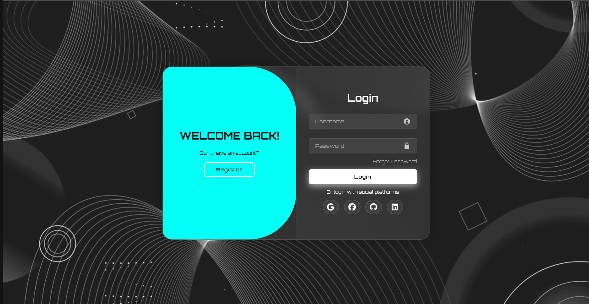
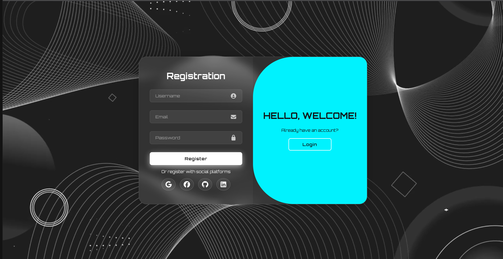

# Animated Login & Registration Form

A front-end login and registration interface built with **HTML, CSS, and
JavaScript**. It combines a looping video background with a
glassmorphism-inspired design and animated transitions between the login
and registration forms.

## Screenshots

| Login Screen | Registration Screen |
| :---: | :---: |
|  |  |

## Features

- Animated transition between login and registration screens
- Full-screen looping video background
- Glassmorphism-inspired translucent form container
- Styled input fields with focus effects
- Button and social-icon hover effects
- Font Awesome icons
- Orbitron font from Google Fonts

## Built With

- **HTML5** --- structure and form elements
- **CSS3** --- layout, styling, effects, and transitions
- **JavaScript** --- switches between login and registration states
- **Font Awesome** --- interface and social icons
- **Google Fonts** --- Orbitron typeface

## Project Structure

``` text
.
├── index.html
├── css/
│   └── style.css
├── js/
│   └── script.js
├── videos/
│   └── 0_Abstract_Background_Geometric_Shapes_1280x720.mp4
├── images/
│   ├── login-preview.png
│   └── registration-preview.png
└── README.md
```

## Getting Started

### Run the project

1. Download or clone this repository.
2. Keep the background video in the `videos` folder, or update the video path in `index.html`.
3. Open `index.html` in your browser.

For local development, you can also open the project folder in Visual
Studio Code and run `index.html` using the Live Server extension.

An internet connection is needed to load the external Google Fonts and
Font Awesome resources.

## How It Works

The Register button adds the `active` class to the main `.container`
element. CSS uses that class to animate the form and toggle panel into
the registration state. The Login button removes the class and returns
the interface to the login state.

The background video is muted, loops automatically, and is positioned
behind the interface.

## Current Scope

This project is currently a **front-end UI demonstration**. The forms do not yet create accounts, authenticate users, or save user information.
The Forgot Password link and social sign-in icons are placeholders and
are not connected to external services.

## Possible Improvements

- Connect login and registration to a secure authentication backend
- Add form validation and user-friendly feedback
- Implement password reset
- Integrate supported social sign-in providers
- Improve the layout for mobile and smaller screens
- Provide a fallback background for users who cannot play video

## License

No license has been specified for this project. Unless a license is
added, reuse and redistribution are not explicitly granted.
